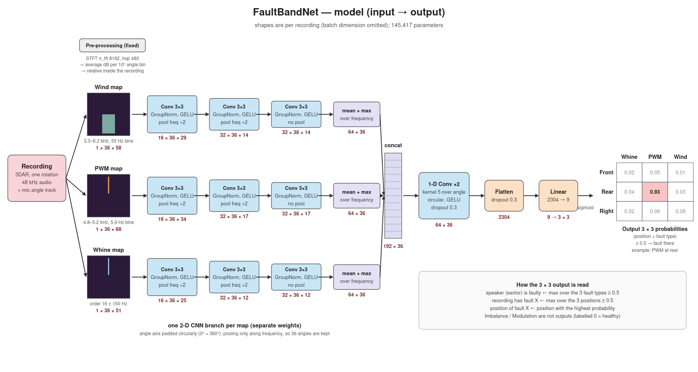
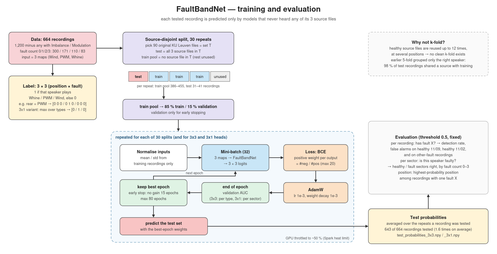
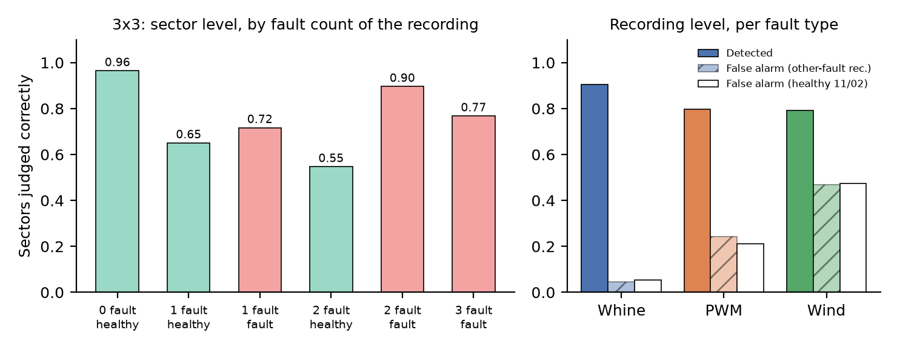
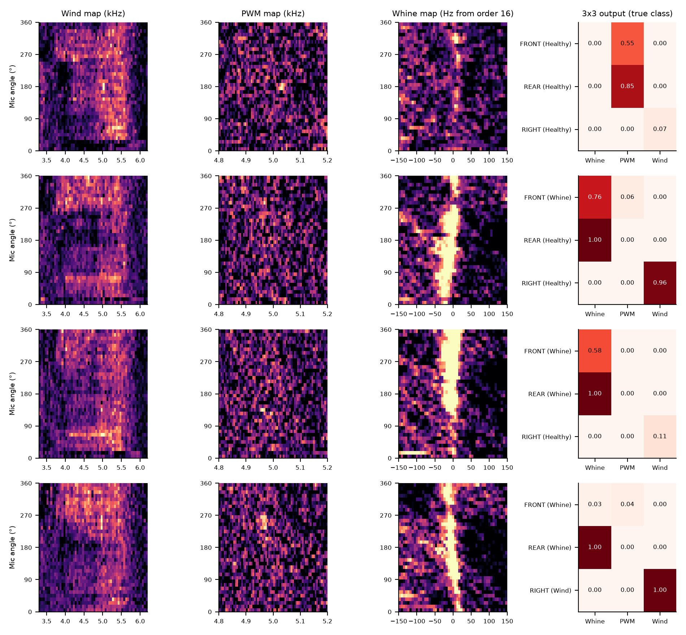

# 3DAR_EV — 전기차 고장음의 위치(와 종류) 찾기

회전하는 메타구조 단일 마이크(3DAR)로 녹음한 소리에서 **어느 방향 스피커에서 고장음이 나는지** 찾는 실험 코드입니다.

- 음원: KU Leuven 전기차 실내 소음 합성 데이터(정상 + 고장 5종)를 스피커 3개(앞·뒤·오른쪽)로 재생
- 녹음: 3DAR이 한 바퀴 도는 동안의 모노 48 kHz 녹음 1,200개(고장 0/1/2/3곳 각 300개)
- **데이터는 이 저장소에 없습니다.** 코드와 결과 정리만 있습니다.
- 개인 컴퓨터(VS Code)에서 이어서 작업하려면 [`CONTINUE_ON_PC.md`](CONTINUE_ON_PC.md)를 보세요.

## 주 모델: FaultBandNet (노트북 한 파일)
[`3DAR_EV_FaultBandNet.ipynb`](3DAR_EV_FaultBandNet.ipynb) — 셀 1 설정·특징·모델·학습, 셀 2 평가, 셀 3–4 그림.

- **입력**: 녹음 1개 → 지도 3장 (마이크 각도 36칸 × 주파수), 모두 녹음 안 상대값
  - Wind 3.3–6.2 kHz (36×58) · PWM 4.8–5.2 kHz (36×68) · Whine order 16 ± 150 Hz (36×51)
  - 각도는 360° 전부, 주파수는 0–24 kHz 중 약 13 %만 사용(고장이 나타나는 대역만)
- **모델**: 지도별 2D CNN → 각도 방향 1D CNN(원형) → FC → **3×3 = 위치 3(앞/뒤/오른쪽) × 고장 3(Whine/PWM/Wind) 확률**
- 서브: 같은 신경망에서 마지막 층만 바꿔 위치별 고장 여부(3×1)만 내는 변형 → [`sub/3DAR_EV_FaultBandNet_3x1.ipynb`](sub/3DAR_EV_FaultBandNet_3x1.ipynb)

- **데이터**: Imbalance·Modulation이 하나라도 들어간 녹음을 빼고 664개(고장 0/1/2/3곳: 300/171/110/83)
- **평가: 원본 음원 비중복 반복 분할 30회.** 어떤 스피커의 KU Leuven 원본 파일도 학습과 시험에 겹치지 않습니다. 643개가 한 번 이상 시험됐고, 녹음별로 시험된 회차의 확률을 평균했습니다.

### 결과 (시험된 녹음 643개, 기준값 0.5)
섹터(스피커) 1개 정상/고장 판별 — 3×3 출력에서 섹터 확률 = 세 고장 중 최대:

| 녹음 | 정상 섹터 맞힘 | 고장 섹터 맞힘 | 섹터 정확도 | 세 섹터 모두 맞힘 |
|---|---|---|---|---|
| 고장 0곳 (292) | 845/876 = 0.96 | — | 0.96 | 0.92 |
| 고장 1곳 (166) | 216/332 = 0.65 | 119/166 = 0.72 | 0.67 | 0.28 |
| 고장 2곳 (106) | 58/106 = 0.55 | 190/212 = 0.90 | 0.78 | 0.42 |
| 고장 3곳 (79) | — | 182/237 = 0.77 | 0.77 | 0.56 |

- 섹터 AUC 0.92(1·2곳 녹음 안 0.82), 회차별 0.91 ± 0.04. 고장 1곳 녹음에서 고장 섹터를 1등으로 고름 0.66 (무작위 0.33)
- 정상 녹음 오탐: 11/09 블록 0.04, **11/02 블록(19개) 0.63**

고장 종류별(녹음 단위):

| 고장 | AUC | 검출 | 오탐: 정상 11/09 / 정상 11/02 / 다른 고장 녹음 | 위치 정답 |
|---|---|---|---|---|
| Whine (136) | 0.99 | 0.90 | 0.00 / 0.05 / 0.05 | 0.80 |
| PWM (223) | 0.93 | 0.80 | 0.03 / 0.21 / 0.24 | 0.90 |
| Wind (178) | 0.89 | 0.79 | 0.02 / 0.47 / **0.47** | (오른쪽에만 있음) |

- 고장 1곳 녹음에서 종류를 정확히 맞힘 0.33
- 노트북을 한 번 실행한 결과입니다. 학습 무작위성으로 실행마다 조금 달라집니다.

### 한계 (꼭 읽어 주세요)
- **고장 녹음 안의 정상 섹터를 고장으로 잘못 판정하는 경우가 많습니다.** 고장 1곳 녹음에서 세 섹터를 모두 맞히는 비율은 약 0.3입니다.
- **Imbalance, Modulation은 대상에서 뺐습니다.** Imbalance(0.1–0.3 kHz)는 녹음에서 저음 잡음에 묻히고, Modulation은 재생한 RPM 구간(5,000–8,000)에 고장 성분이 거의 없습니다.
- **녹음 조건이 라벨과 겹칩니다.** 전부 정상인 녹음 300개 중 280개가 한 시간대(11/09 오전)에 따로 녹음됐고, 그 블록만 0.7–2.5 kHz가 3–8 dB 낮습니다. 11/02에 녹음한 정상 녹음(19개 시험)에서는 오탐이 약 절반입니다.
- 3DAR 지향성은 약 2 kHz 이상에서만 작동합니다. 각도와 시간(RPM 상승)이 함께 진행해 방향 효과와 시간 효과가 섞입니다.
- Wind는 오른쪽 스피커에만 있어 Wind의 위치 구분은 검증되지 않았습니다. Wind는 다른 고장 녹음에서도 자주 오탐합니다.
- 어느 대역을 쓸지는 전체 녹음을 보며 정했으므로 수치는 다소 낙관적일 수 있습니다. 새 녹음(고장 순서를 섞은 녹음)으로 재검증이 필요합니다.
- 이전 버전(5-fold)은 오른쪽 스피커 원본만 묶어서, 시험 녹음의 98 %가 앞·뒤 원본을 학습과 공유했습니다. 그 수치(예: 정상 섹터 0.81)는 음원 암기가 섞인 값입니다.

## 폴더

| 경로 | 내용 |
|---|---|
| `3DAR_EV_FaultBandNet.ipynb` | 주 모델 3×3 (이 README의 결과) |
| `sub/3DAR_EV_FaultBandNet_3x1.ipynb` | 서브: 3×1 (위치별 고장 여부만), 비교용 |
| `figures/` | 모델·학습 구조도와 결과 그림 |
| `CLAUDE.md` | Claude Code 작업 지침 |
| `CONTINUE_ON_PC.md` | 개인 컴퓨터(VS Code)에서 이어서 하기 (설치, 데이터, 첫 프롬프트) |
| `archive/` | 지금까지의 실험 기록 (참고용, 그대로 실행하려면 경로 수정 필요) |

`archive/` 안 주요 기록:
- `experiments/fault_net_noimbmod_20261124/` — 이 노트북의 근거(분할 방식, 3×3·3×1 스크립트 결과)
- `experiments/fault_net_20261124/` — FaultBandNet 첫 버전(5-fold, 5종 변형 포함)
- `experiments/ku_original_20261123/` — KU Leuven 원본 분석, 녹음 조건 차이, 재생·녹음 후 고장 성분 손실
- `experiments/wind_detect_20261124/` — Wind 탐지 방법 탐색, 규칙 기반 판정기
- `experiments/angle_profile_20261123/` — 3DAR 지향성 측정
- `experiments/strict_split_20261123/` 등 — 통째 mel CNN의 한계 확인
- `3DAR_EV_all_in_one.ipynb`, `ev3dar/` — 초기 기준 모델(위치 SSL + 소리 종류 ID)

## 참고 문헌
- D. Kunte et al., "A Domain Knowledge Informed Approach for Anomaly Detection of Electric Vehicle Interior Sounds" (KU Leuven) — 음원 데이터와 고장 정의
- S. Ahn, J.-H. Kim, J. Heo, S.-H. Ahn, "Human-robot and robot-robot sound interaction using a 3-Dimensional Acoustic Ranging (3DAR) in audible and inaudible frequency", Robotics and Computer-Integrated Manufacturing 94 (2025) 102970 — 3DAR
