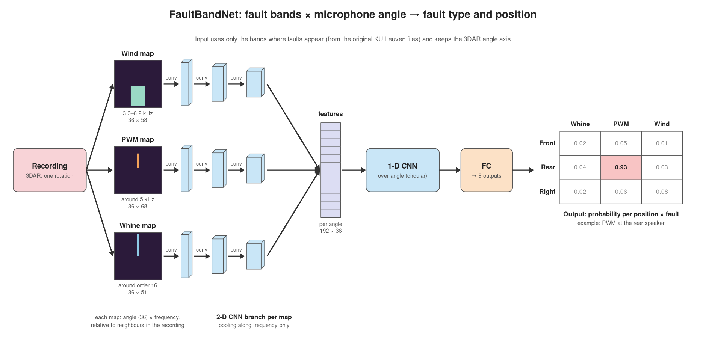
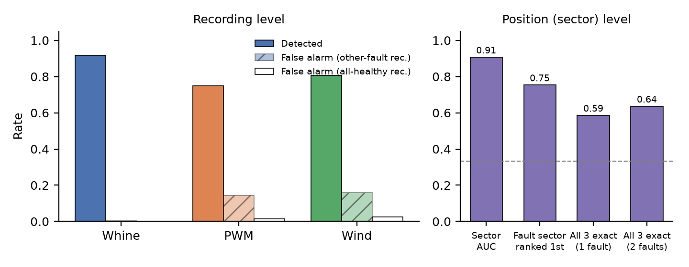
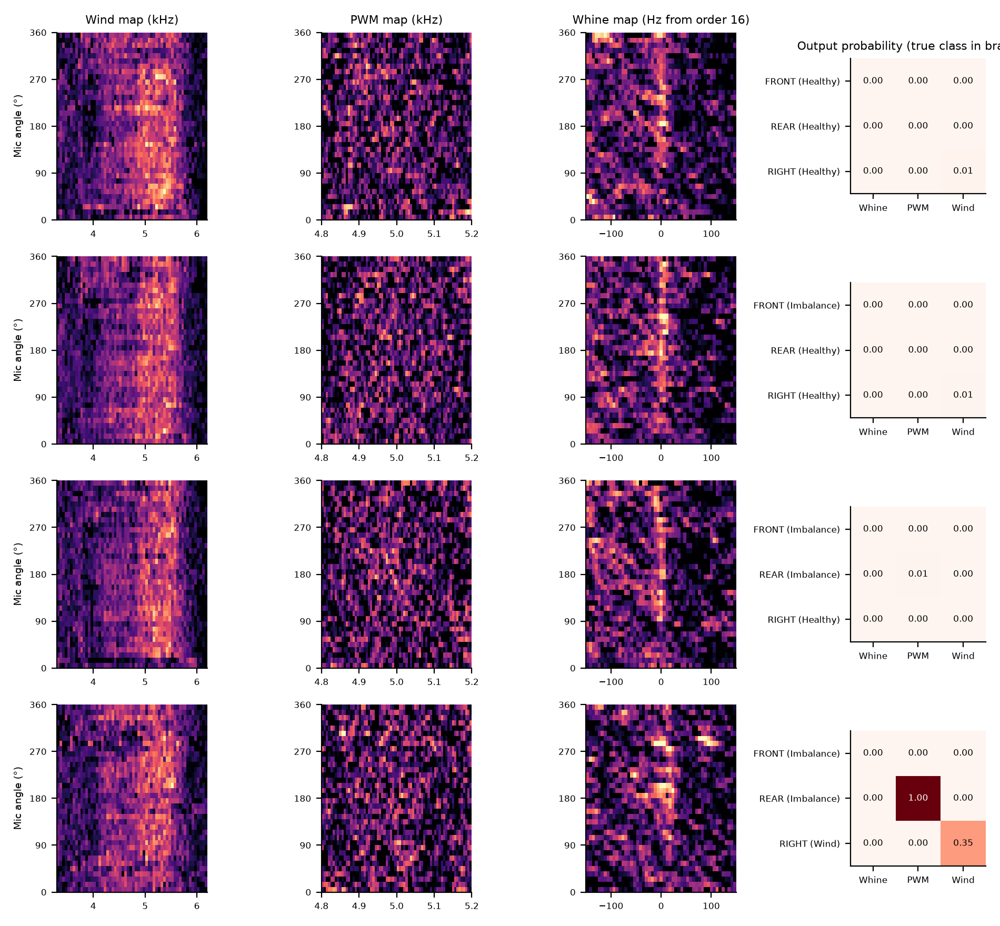

# 3DAR_EV — 전기차 실내 고장음의 종류와 위치 찾기

회전하는 메타구조 단일 마이크(3DAR)로 녹음한 소리에서 **어떤 고장음이 어느 방향 스피커에서 나는지** 찾는 실험 코드입니다.

- 음원: KU Leuven 전기차 실내 소음 합성 데이터(정상 + 고장 5종: Imbalance, Modulation, Whine, Wind, PWM)를 스피커 3개(앞·뒤·오른쪽)로 재생
- 녹음: 3DAR이 약 4초에 한 바퀴 도는 동안의 모노 48 kHz 녹음 1,200개(고장 0/1/2/3곳 각 300개) + 스피커 1개 녹음 200개
- **데이터(녹음 WAV, KU Leuven 원본)는 이 저장소에 없습니다.** 코드와 결과 정리만 있습니다.

## 주 모델: FaultBandNet



스펙트로그램을 통째로 넣지 않고, **고장이 나타나는 대역만** 마이크 각도별로 뽑아 넣습니다.

| 지도 (각도 36칸 × 주파수) | 대역 | 근거 (원본 파일 분석) |
|---|---|---|
| Wind | 3.3–6.2 kHz | 원본에서 Wind는 4.0–5.5 kHz 봉우리(+4–6.5 dB) |
| PWM | 5 kHz 주변 | 5 kHz 고정 선(+14 dB) |
| Whine | order 16 주변 | order 16 선(+14 dB) |

지도별 2D CNN → 각도 방향 1D CNN(원형) → FC → **출력 9개 = 위치 3(앞/뒤/오른쪽) × 고장 3(Whine/PWM/Wind)**.
노트북 한 파일로 실행합니다: [`3DAR_EV_FaultBandNet.ipynb`](3DAR_EV_FaultBandNet.ipynb) (셀 1 설정·특징·모델·학습, 셀 2 평가, 셀 3–4 그림).

### 결과 (녹음 1,200개, 5-fold, 학습에 쓰지 않은 녹음에 대한 판정)

| 고장 | AUC | 검출률 | 오탐 (전부 정상 녹음, 11/09 블록) | 위치 정답률 (앞/뒤) |
|---|---|---|---|---|
| Whine | 1.00 | 0.92 | 0.00 | 0.83 |
| PWM | 0.91 | 0.75 | 0.01 | 0.91 |
| Wind | 0.93 | 0.81 | 0.03 | (오른쪽에만 있음) |

- 셋 중 하나라도 있는 녹음 검출 0.89, 전부 정상 녹음 300개 중 오탐 0.06. 단 11/02에 녹음한 정상 20개에서는 PWM 0.25, Wind 0.20으로 높음
- 고장 1·2곳 녹음 안에서 "이 방향이 고장인가" AUC 0.91, 고장 1곳 녹음에서 고장 방향을 1등으로 고름 0.75 (무작위 0.33)
- 위 숫자는 노트북을 한 번 실행한 결과(학습의 무작위성으로 실행마다 조금 달라짐). 5-fold는 오른쪽 스피커 원본 파일 단위로 나눔
- 세 스피커 원본이 모두 안 겹치는 분할(별도 스크립트 실행, `experiments/fault_net_20261124/RESULTS.md`)에서는 AUC Whine 1.00 / PWM 0.97 / Wind 0.93–0.94 (시험 고장 녹음 5–24개)





### 한계 (꼭 읽어 주세요)
- **Imbalance, Modulation은 대상에서 뺐습니다.** Imbalance(0.1–0.3 kHz)는 녹음에서 저음 잡음에 묻히고, Modulation은 재생한 RPM 구간(5,000–8,000)에 고장 성분이 거의 없습니다(원본 3,000–5,000 RPM에서는 +13 dB, 5,000–7,000 RPM에서는 +1 dB).
- **녹음 조건이 라벨과 겹칩니다.** 전부 정상인 녹음 300개 중 280개가 한 시간대(11/09 오전)에 따로 녹음됐고 그 블록만 0.7–2.5 kHz가 3–8 dB 낮습니다. 통째 스펙트로그램을 넣은 모델(CNN, AE, BEATs)은 고장음보다 이 차이를 배웠습니다. FaultBandNet은 녹음 안 상대값만 써서 영향을 줄였지만, 11/02 정상 녹음 20개의 오탐(PWM 0.25, Wind 0.20)처럼 일부 남아 있습니다.
- 3DAR의 지향성은 약 2 kHz 이상에서만 작동합니다(이 녹음에서 1.5 kHz 미만 0 dB, 1.5–6 kHz 3–9 dB). 각도와 시간(RPM 상승)이 함께 진행해 방향 효과와 시간 효과가 섞입니다.
- Wind는 오른쪽 스피커에만 있어 Wind의 위치 구분은 검증되지 않았습니다.
- 어느 대역·각도를 쓸지는 전체 녹음을 보며 정했으므로 수치는 다소 낙관적일 수 있습니다. 새 녹음으로 재검증이 필요합니다.

## 폴더

| 경로 | 내용 |
|---|---|
| `3DAR_EV_FaultBandNet.ipynb` | 주 모델 (이 README의 결과) |
| `3DAR_EV_all_in_one.ipynb` | 초기 기준 모델: 위치(SSL) + 소리 종류(ID), 통째 mel 입력 |
| `ev3dar/`, `configs/`, `scripts/`, `tests/` | 초기 기준 모델 패키지 |
| `experiments/` | 실험별 코드와 `RESULTS.md` (날짜순) |
| `figures/` | 구조도·분석 그림과 그림 코드 |
| `docs/` | 초기 패키지 설명 |

주요 실험 기록:
- `experiments/ku_original_20261123/` — KU Leuven 원본 분석, 녹음 조건 차이, 재생·녹음 후 고장 성분 손실
- `experiments/wind_detect_20261124/` — Wind 탐지 방법 탐색, 규칙 기반 판정기
- `experiments/fault_net_20261124/` — FaultBandNet
- `experiments/angle_profile_20261123/` — 3DAR 지향성 측정, 각도별 분석
- `experiments/strict_split_20261123/`, `extremes_train_20261123/`, `mixed_train_20261123/` — 통째 mel CNN의 한계 확인
- `experiments/ae_20261119/`, `ae_paper_20261123/` — 정상만 학습하는 오토인코더

## 실행

```bash
pip install -r requirements.txt        # numpy, scipy, soundfile, scikit-learn, matplotlib (PyTorch+CUDA는 환경에 맞게 따로 설치)
# 3DAR_EV_FaultBandNet.ipynb 의 CONFIG['data_root'] 를 측정_목록.csv 가 있는 폴더로 바꾼 뒤 셀을 순서대로 실행
```
- 특징 추출 약 3분(CPU 10코어), 학습 5-fold 수 분(GPU). 실험 스크립트에는 작성 환경의 절대 경로가 들어 있으니 필요하면 바꿔 주세요.

## 참고 문헌
- D. Kunte et al., "A Domain Knowledge Informed Approach for Anomaly Detection of Electric Vehicle Interior Sounds" (KU Leuven) — 음원 데이터와 고장 정의
- S. Ahn, J.-H. Kim, J. Heo, S.-H. Ahn, "Human-robot and robot-robot sound interaction using a 3-Dimensional Acoustic Ranging (3DAR) in audible and inaudible frequency", Robotics and Computer-Integrated Manufacturing 94 (2025) 102970 — 3DAR
